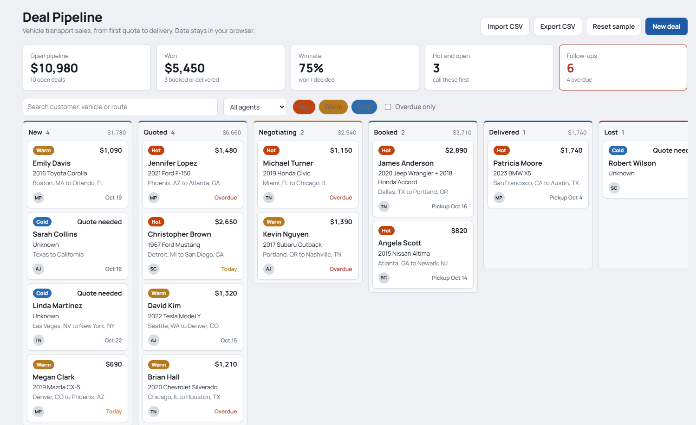

# Deal Pipeline

A small CRM board for vehicle transport deals: New, Quoted, Negotiating, Booked, Delivered, Lost. It is the part that comes after [AI Lead Qualifier](https://github.com/teodor-ninkov/ai-lead-qualifier): you import its results and the scored leads land in New, each with a follow-up date based on its score.

**Demo:** https://teodor-ninkov.github.io/deal-pipeline/ (starts with sample deals, your changes stay in your browser)



## What it does

- Drag deals between stages; every stage change is logged on the deal
- Open a deal to edit it and log calls, emails and notes
- Top strip: open pipeline value, won value, win rate, hot open deals, overdue follow-ups
- Search, filter by agent and score, show only overdue
- CSV import (works with the lead qualifier output) and CSV export

## How it is built

React and TypeScript with Vite, plain CSS, no UI library. State lives in `App.tsx` and is saved to localStorage. The calculations (`lib/metrics.ts`) and the CSV parsing (`lib/csv.ts`) are kept out of the components so they can be tested on their own. Tests use Vitest and Testing Library.

## Problems I hit

- **Blank page on GitHub Pages.** Pages was serving the source `index.html`, which points to `main.tsx`, a file browsers cannot run. The fix: build into `docs/` and point Pages at that folder.
- **CSV with commas and line breaks inside fields.** The follow-up emails from the qualifier contain both. Splitting on commas broke them, so the parser handles quoted fields properly, and there is a test for it.
- **Empty deals piling up.** Clicking New deal and closing the panel left blank cards on the board. Now a deal with no name and no activity is removed when you close it.

## Run locally

```bash
npm install
npm run dev     # local server
npm test        # tests
npm run build   # type check and build into docs/
```
