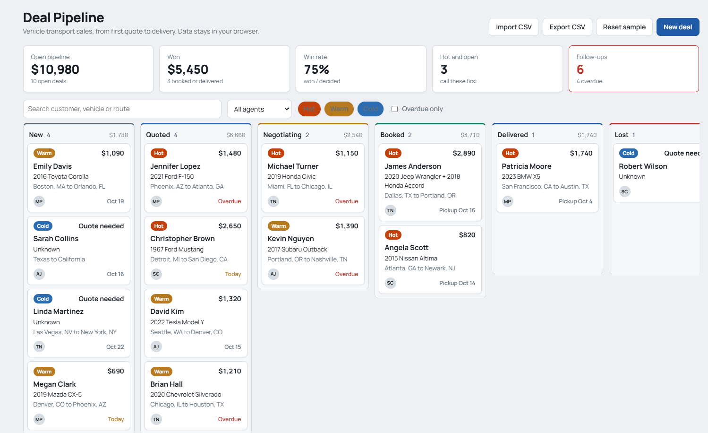

# Deal Pipeline

A CRM board for vehicle transport deals: New, Quoted, Negotiating, Booked, Delivered, Lost. It is the part that comes after [AI Lead Qualifier](https://github.com/teodor-ninkov/ai-lead-qualifier): you import its results and the scored leads land in New, each with a follow-up date based on its score.

**Demo:** https://teodor-ninkov.github.io/deal-pipeline/ (starts with sample deals, your changes stay in your browser)



## What it does

**Board**
- Drag deals between stages. On a phone, press and hold a card, then drag it. With the keyboard, focus a card and press <kbd>Shift</kbd> + <kbd>←</kbd> / <kbd>→</kbd>
- Every stage change is logged on the deal. Open a deal to edit it and log calls, emails and notes
- Top strip: open pipeline value, won value, win rate, hot open deals, overdue follow-ups
- Search, filter by agent and score, show only overdue
- CSV import (works with the lead qualifier output) and CSV export

**Calendar**
- Follow-ups and pickups on a month grid, coloured by lead score
- Drag a follow-up to another day to reschedule it, or send overdue ones to today in one click

**Reports**
- Revenue forecast for six months: won deals in full, open deals weighted by their chance of booking (stage odds adjusted by lead score). A deal whose month has passed while it is still open counts in the current month, so the forecast does not hide slipped deals
- Funnel that counts lost deals as far as they got, read from the stage log
- Win rate by lead score, to check whether the AI scores from the qualifier actually predict bookings
- Agent table and a "going cold" list of open deals nobody has touched for a week
- Everything follows the filters, so you can look at one agent or only Hot leads

**Everywhere**
- Undo and redo for every change (<kbd>Ctrl</kbd> + <kbd>Z</kbd>, <kbd>Ctrl</kbd> + <kbd>Shift</kbd> + <kbd>Z</kbd>), with an Undo button on deletes, moves and imports. Typing in one deal counts as one step
- Light, dark or system theme
- Shortcuts: <kbd>N</kbd> new deal, <kbd>/</kbd> search, <kbd>1</kbd> <kbd>2</kbd> <kbd>3</kbd> switch views

## Team mode (optional)

By default the board lives in your browser. With a free [Supabase](https://supabase.com) project it becomes one shared board: teammates sign in with an emailed link and see each other's changes live.

1. Create a Supabase project.
2. In **SQL Editor**, run [`supabase/schema.sql`](supabase/schema.sql), then add your team: `insert into team_members (email) values ('you@example.com');`
3. In **Authentication > URL Configuration**, add the address you run the app on (for example `http://localhost:5173/deal-pipeline/`) to the redirect URLs.
4. Copy `.env.example` to `.env` and fill in the project URL and anon key from **Project Settings > API**.
5. `npm run dev`.

Only addresses in `team_members` can read or change deals. This is enforced by row level security in the database, not by the app. The public demo is built without these variables, so it stays browser-only and never loads the Supabase code.

## How it is built

React 19 and TypeScript with Vite, plain CSS, no UI or chart library.

- `Pipeline.tsx` holds the board state. Every change goes through a small undo history (`lib/history.ts`).
- Saving is behind one interface (`lib/sync.ts`). In browser mode the list goes to localStorage. In team mode the app works out which deals changed since the last save and sends only those to Supabase, a moment after you stop typing.
- The forecast, funnel and calendar maths (`lib/forecast.ts`, `lib/calendar.ts`), CSV parsing (`lib/csv.ts`) and sync logic are kept out of the components and tested on their own.
- Tests use Vitest and Testing Library, including a fake store for the sync. GitHub Actions runs them, the type check and the build on every push and pull request.

## Problems I hit

- **Blank page on GitHub Pages.** Pages was serving the source `index.html`, which points to `main.tsx`, a file browsers cannot run. The fix: build into `docs/` and point Pages at that folder. CI now fails if `docs/` was not rebuilt after a source change.
- **CSV with commas and line breaks inside fields.** The follow-up emails from the qualifier contain both. Splitting on commas broke them, so the parser handles quoted fields properly, and there is a test for it.
- **Empty deals piling up.** Clicking New deal and closing the panel left blank cards on the board. Now a deal with no name and no activity is removed when you close it, and it is never sent to the server.
- **Undo after every letter.** The first version of undo took back one keystroke at a time. Changes to the same deal that come in quick succession are now merged into one step.
- **My own saves coming back.** Supabase sends every change to every open board, including the one that made it. The app ignores a change that matches what it just saved, and a change to a deal you are still editing waits until your edit is saved, so live updates never overwrite what you are typing.
- **Drag and drop does nothing on phones.** Browsers do not fire HTML drag events for touch. Cards now use a long press to pick up, and scrolling is held off while one is being dragged.

## Run locally

```bash
npm install
npm run dev     # local server
npm test        # tests
npm run build   # type check and build into docs/
```
